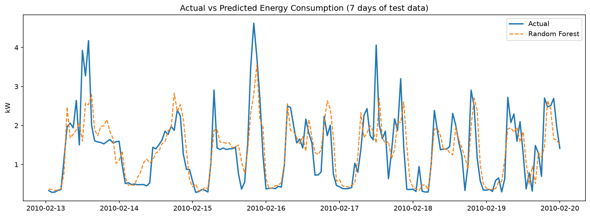
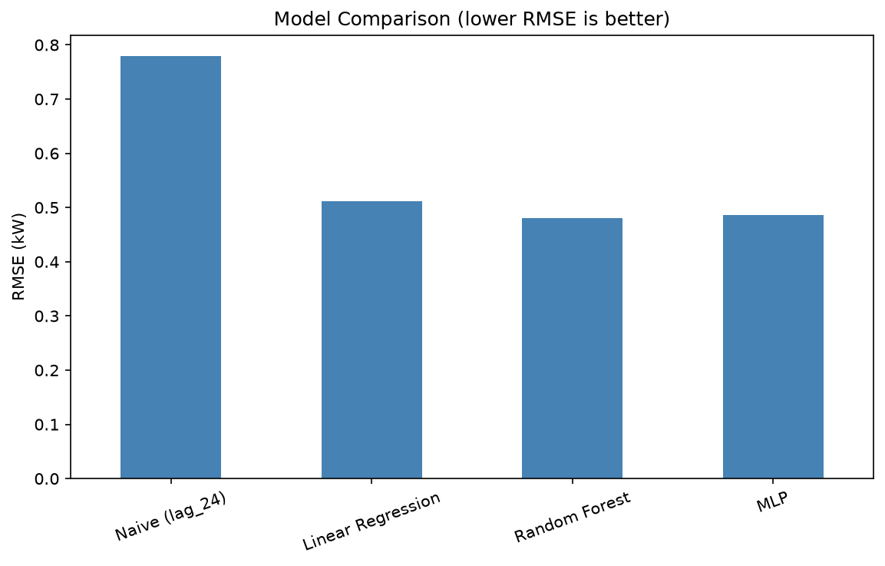
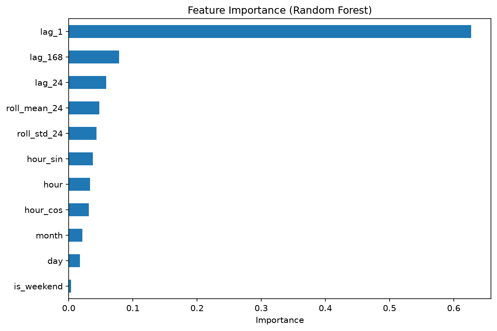
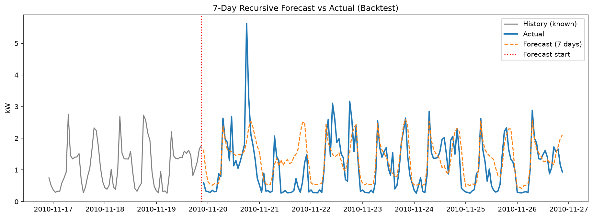

# AI-Powered Energy Consumption Forecasting

Hourly household electricity forecasting using machine learning, with a Flask API for serving predictions.

## Overview
Forecasts household electricity demand (kW) from historical smart-meter data using calendar and lag features. Accurate demand forecasts help utilities plan supply and help buildings shift usage away from peak hours.

## Dataset
[UCI Individual Household Electric Power Consumption](https://archive.ics.uci.edu/dataset/235/individual+household+electric+power+consumption): about 2 million minute-level readings (Dec 2006 to Nov 2010) from one household, resampled to 34,589 hourly values. Download it and place `household_power_consumption.txt` in `data/raw/`.

## Approach
1. Load the raw data and handle missing values (`?`)
2. Resample to hourly means and forward-fill gaps (no future data used)
3. Feature engineering: hour, day, month, weekend flag, cyclical hour encoding, lags (1h, 24h, 168h), 24h rolling mean/std (shifted to prevent leakage)
4. Chronological 80/20 train/test split (no shuffling)
5. Train and compare a naive baseline, Linear Regression, Random Forest and MLP
6. Recursive multi-step forecasting with a backtest
7. Flask API serving forecasts

## Results (test set, Feb to Nov 2010)
| Model | MAE (kW) | RMSE (kW) | R² |
|---|---|---|---|
| Naive (same hour yesterday) | 0.521 | 0.779 | -0.140 |
| Linear Regression | 0.358 | 0.511 | 0.509 |
| **Random Forest** | **0.330** | **0.481** | **0.566** |
| MLP | 0.338 | 0.486 | 0.556 |

Random Forest reduces RMSE by about 38% versus the naive baseline.

**Recursive backtest (final 7 days):** RMSE 0.89 kW over the first 24 hours and 0.64 kW over 7 days. This is a single small window, and errors are higher than one-step prediction because predictions feed back as inputs.






## Project Structure
```
├── src/         data loading, preprocessing, features, training, evaluation, forecasting
├── images/      result charts
├── outputs/     metrics and forecast CSVs
├── app.py       Flask forecast API
├── main.py      runs the full pipeline
└── requirements.txt
```

## How to Run
```bash
python -m venv venv
venv\Scripts\activate        # Windows (source venv/bin/activate on Mac/Linux)
pip install -r requirements.txt
python main.py               # runs the full pipeline
python app.py                # starts the API
```

**API example** (`POST /forecast`):
```json
{"last_timestamp": "2010-11-26 21:00:00",
 "last_168_hours_kw": [ ...168 hourly readings... ],
 "hours_ahead": 6}
```
Returns timestamped forecasts in kW. `python test_api.py` builds a sample request from the dataset.

## Limitations
- Single household; results may not generalize to other buildings
- No weather or holiday data
- Recursive forecasts lose accuracy and smooth out spikes at longer horizons
- Forecasting only, not a production deployment

## What I Learned
Time-series data leakage and chronological splitting, lag and rolling features, baseline comparison, recursive forecasting, and serving a model through an API.

## Author
Yaswitha Kamakshi  GitHub:(https://github.com/@yaswitha-kamakshi) | LinkedIn: (www.linkedin.com/in/yaswitha-kamakshi-292b5242b)